# Knowledge Graph Schema Specification

This document defines the schema, node types, relationship types, property constraints, disambiguations, open fallback normalization rules, and payload contract for the Knowledge Graph component in the privacy-preserving local Voice AI assistant.

---

## 1. Schema Overview

The personal knowledge graph models entities and contextual relationships extracted from user voice conversations across three functional layers:
- **Layer A (Work & Office Meetings)**: Meeting minutes, action items (Task), decisions, issues, blockers, open questions, projects, and goals.
- **Layer B (Personal & Social Life)**: Social relationships (informed by DialogRE), family, friends, workplace, living location, ownership of items, affinities (likes/dislikes), and personal plans.
- **Layer C (Conversation Signals & Metadata)**: Operations (`add`, `update`, `retract`), uncertainty confidence scores, alias resolution, and privacy classifications.

The graph runs locally on Neo4j 5.

### Core Invariants
- **Uniqueness**: Every entity node is uniquely identified by its `key` property. Unique constraints on `key` are dynamically generated from `typing.get_args(NodeLabel)` (e.g. `person_key`, `meeting_key`, `item_key`), guaranteeing zero drift between code models and the database.
- **Range Indexes**: Range indexes are maintained on `Task(priority)`, `Task(status)`, and `Issue(severity)` for accelerated filtering.
- **Node Metadata**: All nodes maintain `key` (normalized identifier), `name` (display name), `created_at` (ISO timestamp), and `updated_at` (ISO timestamp).
- **Schema Versioning**: Payloads include an optional `schema_version: str = "1.0"`. Major version mismatches log a warning without rejecting the payload.
- **Deadline Validation**: Entities of type `Deadline` whose `name` is not an ISO date (`YYYY-MM-DD`) trigger a logged warning, but the entity is kept.
- **Relationship Symmetry & Cardinality**:
  - `SINGLE_VALUED_RELATIONSHIPS = {"DUE_ON", "SCHEDULED_ON", "LIVES_IN"}`
  - `SYMMETRIC_RELATIONSHIPS = {"FRIEND_OF", "PARTNER_OF", "COLLABORATES_WITH"}`
  - Canonical key ordering helper `canonical_pair(rel_type, key_a, key_b)` sorts symmetric relationship node keys.
- **Audit / Conflict Tracking (RP-29 preview)**: Future property conflict tracking will record changes using a `:Change` node (`field`, `old`, `new`, `source`, `at`).
- **Open Fallback Strategy**: Voice conversations contain open-ended language. The engine guarantees no data loss:
  - Unknown entity types are normalized to `Concept` with the raw type stored in `props["original_type"]`.
  - Unknown relationship types or invalid directions are converted to `RELATED_TO` with the raw type stored in `props["label"]`.
  - Unknown values for `priority`, `severity`, and `status` are dropped with a logged warning while keeping the payload valid.
  - Warnings are logged on each fallback.

---

## 2. Node Types (23 Labels)

Nodes are partitioned into **Tier 1 (Core Work & Meeting)** and **Tier 2 (Extended & Supporting)** types.

### Tier 1 Core Labels (12)

| Node Label | Definition & Role | Example |
|:---|:---|:---|
| `Person` | An individual participant, contact, or family member mentioned in conversations. | `Sarah Chen` |
| `Team` | A formal or informal group of people collaborating within an organization. | `Platform Core Team` |
| `Organization` | A company, institution, employer, or enterprise entity. | `InnoTech Labs` |
| `Project` | A coordinated workstream or initiative with defined deliverables. | `Local Voice AI Assistant` |
| `Task` | An actionable work item that someone must do. | `Benchmark Ollama 8B latency` |
| `Meeting` | A scheduled or ad-hoc gathering where people discuss topics and align on work. | `Sprint 14 Architecture Sync` |
| `Decision` | An agreed-upon conclusion, policy, or choice that has already been decided. | `Adopt Ollama 8B 4-bit Quantization` |
| `Issue` | A problem, bug, risk, obstacle, or blocker hindering progress that needs resolution. | `Whisper Memory Limit Exceeded` |
| `Question` | An open, unresolved question or inquiry raised in discussion that requires an answer. | `Can embedding computation use Neural Engine?` |
| `Deadline` | A specific date, time, or target milestone by which something must finish. | `2026-10-18` |
| `Location` | A physical room, office, residential neighborhood, or virtual venue. | `Conference Room A` / `Brooklyn` |
| `Document` | A written file, specification, design doc, PRD, or meeting agenda. | `RFC-204 Local Graph Storage Architecture` |

### Disambiguating Meeting-Minutes Concepts
When extracting knowledge from spoken office conversations:
- **Decision** = *Already agreed*. A resolution has been achieved and agreed upon by the team or leader.
- **Task** = *Someone must do*. An actionable assignment given to an owner with an expectation of completion.
- **Idea** = *Suggestion not yet decided*. A proposal or exploratory thought submitted for feedback.
- **Issue** = *Problem / risk / blocker*. An active bug, failure, impediment, or vulnerability requiring resolution.
- **Question** = *Open question needing an answer*. An unanswered inquiry or uncertainty raised during discussion.

### Tier 2 Extended Labels (11)

| Node Label | Definition & Role | Example |
|:---|:---|:---|
| `Goal` | A high-level strategic objective or outcome that projects/tasks support. | `Sub-500ms Voice Response Latency` |
| `Idea` | A proposed suggestion or possibility put forward for consideration (not yet decided). | `Cache acoustic embeddings in SQLite` |
| `Tool` | A software tool, framework, runtime, or platform used by teams or projects. | `Neo4j 5` |
| `Metric` | A quantitative benchmark, measurement, or performance indicator. | `P99 Latency: 120ms` |
| `Event` | A calendar occurrence, celebration, release date, or personal milestone event. | `Birthday Party` / `Private Beta Release` |
| `Topic` | A subject area, domain, or theme discussed in meetings, notes, or decisions. | `Memory Optimization and Quantization` |
| `Concept` | A domain concept, entity, or fallback node for unrecognized entity types. | `Zero-Knowledge Encryption` |
| `Preference` | A stated user preference, constraint, or work habit. | `Prefers afternoon sync meetings` |
| `Note` | A freeform text note, memo, or excerpt. | `Takeaway notes from retro` |
| `Conversation` | A recorded speech interaction or voice session transcript. | `voice_convo_20261011_1030` |
| `Item` | A physical product, grocery, purchased good, device, or tangible physical object. | `Oat milk` / `Sony Headphones` |

---

## 3. Allowed Properties Whitelist & Constraints

Property values must be scalar types (`str`, `int`, `float`, `bool`) with the exception of `aliases` which is a list of non-empty strings.

| Property Key | Description | Type / Constraint |
|:---|:---|:---|
| `status` | Lifecycle state. Allowed: `open`, `in progress`, `blocked`, `done`, `cancelled`, `planned`, `active`, `agreed`, `superseded`, `answered`. Case-insensitive synonyms: `completed`/`complete`/`finished` -> `done`; `in-progress`/`ongoing`/`started`/`wip` -> `in progress`; `canceled`/`dropped`/`called off` -> `cancelled`; `pending`/`todo`/`to do`/`new` -> `open`; `waiting`/`stuck` -> `blocked`. Unknown values dropped with logged warning. | `str` |
| `priority` | Priority ranking. Allowed: `low`, `medium`, `high`, `urgent`. Case-insensitive synonyms: `critical`/`asap`/`immediately` -> `urgent`; `important` -> `high`; `normal`/`ok`/`moderate` -> `medium`; `minor`/`whenever`/`optional` -> `low`. Unknown values dropped with logged warning. | `str` |
| `progress` | Numerical or status completion progress indicator. | `str`, `int`, `float` |
| `date` | ISO-formatted date string (`YYYY-MM-DD`). | `str` |
| `time` | Time string (`HH:MM:SS`). | `str` |
| `duration` | Meeting or task duration (e.g. `45m`, `1h`). | `str`, `int`, `float` |
| `recurrence` | Recurrence frequency (e.g. `weekly`, `biweekly`). | `str` |
| `value` | Measured or target metric numerical value. | `int`, `float`, `str` |
| `unit` | Unit of measurement (e.g. `ms`, `%`, `MB`). | `str` |
| `title` | Formal title of a document, role, or meeting. | `str` |
| `severity` | Issue severity level. Allowed: `low`, `medium`, `high`, `critical`. Case-insensitive synonyms: `blocker` -> `critical`; `major` -> `high`; `minor` -> `low`; `normal` -> `medium`. Unknown values dropped with logged warning. | `str` |
| `kind` | Sub-category classifier (e.g. `sister`, `mother`, `electronics`). | `str` |
| `description` | Text description, notes, or detailed explanation. | `str` |
| `rationale` | Architectural or logical reason for a decision. | `str` |
| `quote` | Verbatim quote from voice conversation audio. | `str` |
| `timestamp` | ISO-8601 timestamp string. | `str` |
| `confidence` | Model extraction confidence score between `0.0` and `1.0`. | `float` (0.0 to 1.0) |
| `label` | Preserves original relationship type when normalized to `RELATED_TO`. | `str` |
| `original_type` | Preserves original entity type when normalized to `Concept`. | `str` |
| `age` | Age in years. | `int`, `str` |
| `aliases` | List of alternate names, nicknames, or aliases. | `list[str]` (non-empty strings) |
| `email` | Email address string. | `str` |
| `phone` | Phone number string. | `str` |
| `birthday` | ISO date string (`YYYY-MM-DD`). Not parsed. | `str` |
| `sensitivity` | Privacy flag. Must be `"normal"` or `"private"`. | `str` (`normal` \| `private`) |
| `speaker` | Speaker identity identifier in multi-speaker audio. | `str` |

---

## 4. Layer C Conversation Signals

Entities and relationships carry an `op` field representing lifecycle operation signals from conversations:

| Signal / Field | Value | Meaning | Spoken Utterance Example |
|:---|:---|:---|:---|
| `op` | `add` | Create if missing (default). | "Sarah is leading the new mobile project." |
| `op` | `update` | Correction trigger for conflict resolution. | "No, I meant Tuesday, not Wednesday." |
| `op` | `retract` | Cancellation / negation trigger. | "Cancel that meeting with David." |
| `confidence` | `0.0` - `1.0` | Uncertainty quantification. | "Maybe Friday" -> `confidence: 0.5` |
| `ALIAS_OF` | Edge | Entity resolution between same-label nodes. | "Sarah is also called Sarah Perera" |

---

## 5. Relationship Types & Directions (45 Types)

### Tier 1 Relationships (15 Core Relations)
Used heavily in LLM extraction prompts and core graph traversal:

| Relationship Type | Source (`From`) | Target (`To`) | Description |
|:---|:---|:---|:---|
| `ASSIGNED_TO` | `Task` | `Person` | Person responsible for completing task |
| `PART_OF` | `Task` \| `Project` | `Project` \| `Task` | Subtask or subproject hierarchy |
| `DUE_ON` | `Task` \| `Project` \| `Goal` | `Deadline` | Due date deadline link |
| `ATTENDED` | `Person` | `Meeting` \| `Event` | Person attended a meeting or event |
| `ABSENT_FROM` | `Person` | `Meeting` \| `Event` | Person was absent from a meeting or event |
| `DECIDED` | `Person` | `Decision` | Person who made or championed decision |
| `RAISED` | `Person` | `Issue` \| `Question` | Person who brought up issue or question |
| `BLOCKED_BY` | `Task` \| `Project` | `Issue` \| `Task` | Blocker dependency |
| `DISCUSSED` | `Meeting` | Any node label | Topics/entities covered in meeting |
| `WORKS_ON` | `Person` | `Project` | Person contributes to project |
| `MEMBER_OF` | `Person` | `Team` \| `Organization` | Person belongs to a team or organization |
| `REQUESTED_BY` | `Task` | `Person` | Person who requested the task |
| `LOCATED_AT` | `Meeting` \| `Event` \| `Task` | `Location` | Physical or virtual venue |
| `FRIEND_OF` | `Person` | `Person` | Interpersonal friendship link |
| `FAMILY_OF` | `Person` | `Person` | Kinship link (use `kind='sister'/'mother'`) |

### Tier 2 Relationships (30 Extended & Supporting Relations)

| Relationship Type | Source (`From`) | Target (`To`) | Description |
|:---|:---|:---|:---|
| `LEADS` | `Person` | `Team` \| `Project` \| `Meeting` | Person directs or chairs team, project, meeting |
| `REPORTS_TO` | `Person` | `Person` | Managerial reporting relationship |
| `COLLABORATES_WITH` | `Person` | `Person` | Peer working collaboration |
| `DEPENDS_ON` | `Task` \| `Project` | `Task` \| `Project` | Pre-requisite dependency |
| `FOLLOW_UP_OF` | `Task` \| `Meeting` | `Task` \| `Meeting` | Next step stemming from prior item |
| `SUPPORTS` | `Task` \| `Project` | `Goal` | Action item supporting strategic goal |
| `SCHEDULED_ON` | `Meeting` \| `Event` | `Deadline` | Scheduled occurrence time link |
| `CREATED_IN` | `Task` \| `Decision` \| `Issue` \| `Question` \| `Idea` \| `Note` \| `Document` | `Meeting` \| `Conversation` | Origin context of an artifact |
| `PROPOSED` | `Person` | `Idea` | Person who proposed an idea |
| `HAS_ISSUE` | `Project` \| `Task` | `Issue` | Direct link to known issue |
| `RESOLVES` | `Task` \| `Decision` | `Issue` | Task or decision resolving an issue |
| `ANSWERS` | `Decision` \| `Note` | `Question` | Answer answering open question |
| `SUPERSEDES` | `Decision` | `Decision` | Decision replacing an earlier one |
| `AGREES_WITH` | `Person` | `Idea` \| `Decision` \| `Person` | Agreement with idea, decision, or person |
| `DISAGREES_WITH` | `Person` | `Idea` \| `Decision` \| `Person` | Dissent against idea, decision, or person |
| `REFERENCES` | `Meeting` \| `Task` \| `Project` \| `Note` \| `Decision` | `Document` | Reference to document or spec |
| `USES` | `Project` \| `Task` \| `Team` | `Tool` | Usage of tool or technology |
| `HAS_METRIC` | `Project` \| `Task` \| `Goal` \| `Meeting` \| `Decision` | `Metric` | Performance metric link |
| `ABOUT` | `Note` \| `Decision` \| `Idea` \| `Meeting` \| `Conversation` | `Topic` | Subject matter topic |
| `PREFERS` | `Person` | `Preference` \| `Concept` | Personal habit/preference link |
| `MENTIONS` | `Note` \| `Conversation` | Any node label | Mentioned entity reference |
| `RELATED_TO` | Any node label | Any node label | Open fallback association |
| `PARTNER_OF` | `Person` | `Person` | Domestic or romantic partnership |
| `WORKS_AT` | `Person` | `Organization` | Workplace affiliation |
| `LIVES_IN` | `Person` | `Location` | Residential location |
| `LIKES` | `Person` | Any node label | Positive affinity/opinion |
| `DISLIKES` | `Person` | Any node label | Negative aversion/opinion |
| `ALIAS_OF` | Any node label | Same node label | Alias resolution (must have matching labels) |
| `OWNS` | `Person` \| `Team` \| `Organization` | `Item` \| `Document` \| `Tool` | Ownership of physical or digital item |
| `PLANS` | `Person` | `Event` \| `Task` \| `Meeting` | Personal plan or intended commitment |

### Relationship Categories & Helper Rules
- **Single-Valued Relationships** (`SINGLE_VALUED_RELATIONSHIPS`):
  `{"DUE_ON", "SCHEDULED_ON", "LIVES_IN"}`
  An entity should only have a single active target for these types.
- **Symmetric Relationships** (`SYMMETRIC_RELATIONSHIPS`):
  `{"FRIEND_OF", "PARTNER_OF", "COLLABORATES_WITH"}`
  Bi-directional social or collaborative links.
- **Canonical Ordering**:
  Helper function `canonical_pair(rel_type, key_a, key_b)` returns `tuple(sorted((key_a, key_b)))` for symmetric relationship types, preserving stable deduplication during ingestion.

---

## 6. Layered Schema Diagram

```mermaid
erDiagram
    %% Layer A: Work & Meeting
    PERSON ||--o{ MEETING : "ATTENDED / LEADS"
    PERSON ||--o{ TASK : "ASSIGNED_TO (Task -> Person)"
    PERSON ||--o{ PROJECT : "WORKS_ON"
    PERSON ||--o{ DECISION : "DECIDED"
    PERSON ||--o{ ISSUE : "RAISED"
    PERSON ||--o{ QUESTION : "RAISED"
    MEETING ||--o{ LOCATION : "LOCATED_AT"
    TASK ||--o{ PROJECT : "PART_OF"
    DECISION ||--o{ ISSUE : "RESOLVES"
    DECISION ||--o{ QUESTION : "ANSWERS"

    %% Layer B: Personal & Social Life
    PERSON ||--o{ PERSON : "FAMILY_OF / PARTNER_OF / FRIEND_OF"
    PERSON ||--o{ ORGANIZATION : "WORKS_AT"
    PERSON ||--o{ LOCATION : "LIVES_IN"
    PERSON ||--o{ ITEM : "OWNS / LIKES / DISLIKES"
    PERSON ||--o{ EVENT : "PLANS / ATTENDED"

    %% Layer C: Signals & Disambiguation
    PERSON ||--o{ PERSON : "ALIAS_OF"
    ITEM ||--o{ ITEM : "ALIAS_OF"

    PERSON {
        string key PK
        string name
        list aliases
        string birthday
        string sensitivity
        string op
    }
    ITEM {
        string key PK
        string name
        string kind
        string op
    }
    EVENT {
        string key PK
        string name
        string date
        string op
    }
    MEETING {
        string key PK
        string name
        string date
        string op
    }
    DECISION {
        string key PK
        string name
        string rationale
        string op
    }
    TASK {
        string key PK
        string name
        string priority
        string op
    }
```

---

## 7. Contract Files

- **Type Definitions Dictionary**: `knowledge_graph/contracts/type_definitions.json`
- **JSON Schema**: `knowledge_graph/contracts/graph_payload.schema.json`
- **Work / Meeting Example Payload**: `knowledge_graph/contracts/graph_payload.example.json`
- **Everyday / Personal Example Payload**: `knowledge_graph/contracts/graph_payload.personal.example.json`
