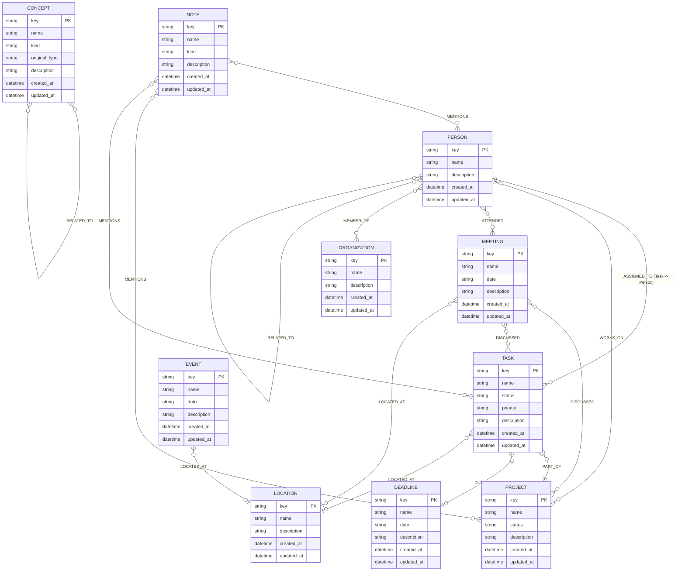

# Knowledge Graph Schema Specification

This document defines the schema, node types, relationship types, property constraints, open fallback normalization rules, and payload contract for the Knowledge Graph component in the privacy-preserving local Voice AI assistant.

---

## 1. Schema Overview

The personal knowledge graph models entities and contextual relationships extracted from user voice conversations. The graph runs locally on Neo4j 5.

### Core Invariants
- **Uniqueness**: Every entity node is uniquely identified by its `key` property. All 10 node types enforce unique database constraints on `key`.
- **Node Metadata**: All nodes maintain `key` (normalized identifier), `name` (display name), `created_at` (ISO timestamp), and `updated_at` (ISO timestamp).
- **Audit / Conflict Tracking (RP-29 preview)**: Future property conflict tracking will record changes using a `:Change` node (`field`, `old`, `new`, `source`, `at`).
- **Open Fallback Strategy**: Voice conversations produce diverse entity types and flexible relations. To prevent data loss, the engine preserves unrecognized entity types as `Concept` and unrecognized/misaligned relationships as `RELATED_TO` with origin metadata preserved.

---

## 2. Node Types & Properties

| Node Label | Description | Allowed Whitelisted Properties |
|:---|:---|:---|
| `Person` | Individual or contact mentioned in conversations | `description` |
| `Task` | Action item or task to be performed | `status`, `priority`, `description` |
| `Project` | Workstream or initiative containing tasks | `status`, `description` |
| `Meeting` | Calendar event or discussion session | `date`, `description` |
| `Deadline` | Time target or due date | `date`, `description` |
| `Organization` | Company, institution, or team entity | `description` |
| `Location` | Physical or virtual place | `description` |
| `Event` | Milestone, launch, or calendar event | `date`, `description` |
| `Concept` | General concept, topic, or fallback entity | `kind`, `original_type`, `description` |
| `Note` | Freeform markdown note or summary | `kind`, `description` |

### Whitelisted Properties & Types
Property values must be scalar types (`str`, `int`, `float`, `bool`). Nested objects or lists are disallowed.

- `status`: Lifecycle state (e.g., `in_progress`, `completed`, `active`).
- `priority`: Priority level (e.g., `low`, `medium`, `high`).
- `date`: ISO-formatted date string (`YYYY-MM-DD`).
- `description`: Text notes or descriptions.
- `label`: Preserves original relationship type when normalized to `RELATED_TO`.
- `original_type`: Preserves original entity type when normalized to `Concept`.
- `kind`: Sub-category or classification for concepts or notes.

---

## 3. Relationship Types & Directions

| Relationship Type | Source (`From`) | Target (`To`) | Description |
|:---|:---|:---|:---|
| `ASSIGNED_TO` | `Task` | `Person` | Indicates person responsible for a task |
| `PART_OF` | `Task` | `Project` | Associates task with its parent project |
| `WORKS_ON` | `Person` | `Project` | Associates person with a project |
| `ATTENDED` | `Person` | `Meeting` | Records attendee presence at a meeting |
| `DISCUSSED` | `Meeting` | `Project` \| `Task` | Topic or action item discussed in meeting |
| `DUE_ON` | `Task` | `Deadline` | Associates task with a deadline |
| `LOCATED_AT` | `Meeting` \| `Event` \| `Task` | `Location` | Specifies physical or virtual location |
| `MEMBER_OF` | `Person` | `Organization` | Affiliation between a person and organization |
| `MENTIONS` | `Note` | Any node label | Links a note to referenced entities |
| `RELATED_TO` | Any node label | Any node label | Generic association / open fallback edge |

---

## 4. Normalization & Fallback Rules

To ensure robustness against noisy or unanticipated voice extraction outputs without losing information:

1. **Entity Type Fallback**:
   - If an incoming entity type is not one of the 10 standard labels, it is normalized to `Concept`.
   - The original raw type string is saved in `props["original_type"]`.
   - A warning is logged.
2. **Relationship Type & Direction Fallback**:
   - If a relationship type is unknown OR its source/target labels do not conform to `ALLOWED_DIRECTIONS`, it is normalized to `RELATED_TO`.
   - The original relationship type string is saved in `props["label"]`.
   - A warning is logged.
3. **Entity Name Validation**:
   - Entity names are stripped of whitespace and must be non-empty (empty names raise validation errors).
4. **Key Normalization Rule**:
   - Node keys are normalized via `normalize_key(name)`: strip, lowercase, collapse consecutive whitespace.
   - Example: `"  Sarah   Perera "` -> `"sarah perera"`.

---

## 5. Schema Diagram

---

## 6. JSON Payload Contract

- JSON Schema: `shared/schemas/graph_payload.schema.json`
- Example Payload: `shared/schemas/graph_payload.example.json`
