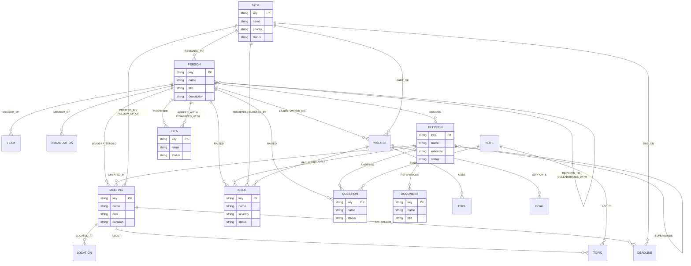

# Knowledge Graph Schema Specification

This document defines the schema, node types, relationship types, property constraints, disambiguations, open fallback normalization rules, and payload contract for the Knowledge Graph component in the privacy-preserving local Voice AI assistant.

---

## 1. Schema Overview

The personal knowledge graph models entities and contextual relationships extracted from user voice conversations and office meetings (~10 people). The graph runs locally on Neo4j 5.

### Core Invariants
- **Uniqueness**: Every entity node is uniquely identified by its `key` property. Unique constraints on `key` are dynamically generated from `typing.get_args(NodeLabel)` (e.g. `person_key`, `meeting_key`, `decision_key`), guaranteeing zero drift between code models and the database.
- **Node Metadata**: All nodes maintain `key` (normalized identifier), `name` (display name), `created_at` (ISO timestamp), and `updated_at` (ISO timestamp).
- **Audit / Conflict Tracking (RP-29 preview)**: Future property conflict tracking will record changes using a `:Change` node (`field`, `old`, `new`, `source`, `at`).
- **Open Fallback Strategy**: Voice conversations contain open-ended language. The engine guarantees no data loss:
  - Unknown entity types are normalized to `Concept` with the raw type stored in `props["original_type"]`.
  - Unknown relationship types or invalid directions are converted to `RELATED_TO` with the raw type stored in `props["label"]`.
  - Warnings are logged on each fallback.

---

## 2. Node Types & Disambiguation

Nodes are partitioned into **Tier 1 (Core)** and **Tier 2 (Extended / Supporting)** types.

### Tier 1 Core Labels (12)

| Node Label | Definition & Role | Example |
|:---|:---|:---|
| `Person` | An individual participant, employee, or stakeholder mentioned in conversations. | `Sarah Chen` |
| `Team` | A formal or informal group of people collaborating within an organization. | `Platform Core Team` |
| `Organization` | A company, institution, partner, or enterprise entity. | `InnoTech Labs` |
| `Project` | A coordinated workstream or initiative with defined deliverables. | `Local Voice AI Assistant` |
| `Task` | An actionable work item that someone must do. | `Benchmark Ollama 8B latency` |
| `Meeting` | A scheduled or ad-hoc gathering where people discuss topics and align on work. | `Sprint 14 Architecture Sync` |
| `Decision` | An agreed-upon conclusion, policy, or choice that has already been decided. | `Adopt Ollama 8B 4-bit Quantization` |
| `Issue` | A problem, bug, risk, obstacle, or blocker hindering progress that needs resolution. | `Whisper Memory Limit Exceeded` |
| `Question` | An open, unresolved question or inquiry raised in discussion that requires an answer. | `Can embedding computation use Neural Engine?` |
| `Deadline` | A specific date, time, or target milestone by which something must finish. | `2026-10-18` |
| `Location` | A physical room, office, or virtual platform where a meeting/event occurs. | `Conference Room A` |
| `Document` | A written file, specification, design doc, PRD, or meeting agenda. | `RFC-204 Local Graph Storage Architecture` |

### Disambiguating Meeting-Minutes Concepts
When extracting knowledge from spoken office conversations:
- **Decision** = *Already agreed*. A resolution has been achieved and agreed upon by the team or leader.
- **Task** = *Someone must do*. An actionable assignment given to an owner with an expectation of completion.
- **Idea** = *Suggestion not yet decided*. A proposal or exploratory thought submitted for feedback.
- **Issue** = *Problem / risk / blocker*. An active bug, failure, impediment, or vulnerability requiring resolution.
- **Question** = *Open question needing an answer*. An unanswered inquiry or uncertainty raised during the discussion.

### Tier 2 Extended Labels (10)

| Node Label | Definition & Role | Example |
|:---|:---|:---|
| `Goal` | A high-level strategic objective or outcome that projects/tasks support. | `Sub-500ms Voice Response Latency` |
| `Idea` | A proposed suggestion or possibility put forward for consideration (not yet decided). | `Cache acoustic embeddings in SQLite` |
| `Tool` | A software tool, framework, runtime, or platform used by teams or projects. | `Neo4j 5` |
| `Metric` | A quantitative benchmark, measurement, or performance indicator. | `P99 Latency: 120ms` |
| `Event` | A calendar occurrence, public demo, release date, or milestone event. | `Private Beta Release Demo` |
| `Topic` | A subject area, domain, or theme discussed in meetings, notes, or decisions. | `Memory Optimization and Quantization` |
| `Concept` | A domain concept, entity, or fallback node for unrecognized entity types. | `Zero-Knowledge Encryption` |
| `Preference` | A stated user preference, constraint, or work habit. | `Prefers afternoon sync meetings` |
| `Note` | A freeform text note, memo, or excerpt. | `Takeaway notes from retro` |
| `Conversation` | A recorded speech interaction or voice session transcript. | `voice_convo_20261011_1030` |

---

## 3. Allowed Properties Whitelist

Properties must be scalar types (`str`, `int`, `float`, `bool`). Nested dictionaries and lists are rejected.

| Property Key | Description | Allowed Value Types |
|:---|:---|:---|
| `status` | Lifecycle state (e.g. `open`, `in_progress`, `decided`, `resolved`, `active`). | `str` |
| `priority` | Priority ranking (e.g. `low`, `medium`, `high`, `critical`). | `str` |
| `progress` | Numerical or status completion progress indicator. | `str`, `int`, `float` |
| `date` | ISO-formatted date string (`YYYY-MM-DD`). | `str` |
| `time` | Time string (`HH:MM:SS`). | `str` |
| `duration` | Meeting or task duration (e.g. `45m`, `1h`). | `str`, `int`, `float` |
| `recurrence` | Recurrence frequency (e.g. `weekly`, `biweekly`). | `str` |
| `value` | Measured or target metric numerical value. | `int`, `float`, `str` |
| `unit` | Unit of measurement (e.g. `ms`, `%`, `MB`). | `str` |
| `title` | Formal title of a document, role, or meeting. | `str` |
| `severity` | Issue severity level (e.g. `low`, `high`, `blocker`). | `str` |
| `kind` | Sub-category classifier. | `str` |
| `description` | Text description, notes, or detailed explanation. | `str` |
| `rationale` | Architectural or logical reason for a decision. | `str` |
| `quote` | Verbatim quote from voice conversation audio. | `str` |
| `timestamp` | ISO-8601 timestamp string. | `str` |
| `confidence` | Model extraction confidence score (0.0 to 1.0). | `float` |
| `label` | Preserves original relationship type when normalized to `RELATED_TO`. | `str` |
| `original_type` | Preserves original entity type when normalized to `Concept`. | `str` |

---

## 4. Relationship Types & Directions (35 Types)

| Relationship Type | Source (`From`) | Target (`To`) | Description |
|:---|:---|:---|:---|
| `MEMBER_OF` | `Person` | `Team` \| `Organization` | Person belongs to a team or organization |
| `LEADS` | `Person` | `Team` \| `Project` \| `Meeting` | Person directs or chairs team, project, or meeting |
| `REPORTS_TO` | `Person` | `Person` | Managerial reporting relationship |
| `COLLABORATES_WITH` | `Person` | `Person` | Peer working collaboration |
| `ATTENDED` | `Person` | `Meeting` | Person attended a meeting |
| `ABSENT_FROM` | `Person` | `Meeting` | Person was absent from a meeting |
| `ASSIGNED_TO` | `Task` | `Person` | Person responsible for completing task |
| `REQUESTED_BY` | `Task` | `Person` | Person who requested the task |
| `WORKS_ON` | `Person` | `Project` | Person contributes to project |
| `PART_OF` | `Task` \| `Project` | `Project` \| `Task` | Subtask or subproject hierarchy |
| `DEPENDS_ON` | `Task` \| `Project` | `Task` \| `Project` | Pre-requisite dependency |
| `BLOCKED_BY` | `Task` \| `Project` | `Issue` \| `Task` | Blocker dependency |
| `FOLLOW_UP_OF` | `Task` \| `Meeting` | `Task` \| `Meeting` | Next step stemming from prior item |
| `SUPPORTS` | `Task` \| `Project` | `Goal` | Action item supporting strategic goal |
| `DUE_ON` | `Task` \| `Project` \| `Goal` | `Deadline` | Due date deadline link |
| `SCHEDULED_ON` | `Meeting` \| `Event` | `Deadline` | Scheduled occurrence time link |
| `LOCATED_AT` | `Meeting` \| `Event` \| `Task` | `Location` | Physical or virtual venue |
| `CREATED_IN` | `Task` \| `Decision` \| `Issue` \| `Question` \| `Idea` \| `Note` \| `Document` | `Meeting` \| `Conversation` | Origin context of an artifact |
| `DISCUSSED` | `Meeting` | Any node label | Topics/entities covered in meeting |
| `DECIDED` | `Person` | `Decision` | Person who made or championed decision |
| `RAISED` | `Person` | `Issue` \| `Question` | Person who brought up issue or question |
| `PROPOSED` | `Person` | `Idea` | Person who proposed an idea |
| `HAS_ISSUE` | `Project` \| `Task` | `Issue` | Direct link to known issue |
| `RESOLVES` | `Task` \| `Decision` | `Issue` | Task or decision resolving an issue |
| `ANSWERS` | `Decision` \| `Note` | `Question` | Answer answering open question |
| `SUPERSEDES` | `Decision` | `Decision` | Decision replacing an earlier one |
| `AGREES_WITH` | `Person` | `Idea` \| `Decision` \| `Person` | Agreement with idea, decision, or person |
| `DISAGREES_WITH` | `Person` | `Idea` \| `Decision` \| `Person` | Dissent against idea, decision, or person |
| `REFERENCES` | `Meeting` \| `Task` \| `Project` \| `Note` \| `Decision` | `Document` | Reference to document or spec |
| `USES` | `Project` \| `Task` \| `Team` | `Tool` | Usage of tool or technology |
| `HAS_METRIC` | `Project` \| `Task` \| `Goal` \| `Meeting` \| `Decision` | `Metric` | Performance metric link |
| `ABOUT` | `Note` \| `Decision` \| `Idea` \| `Meeting` \| `Conversation` | `Topic` | Subject matter topic |
| `PREFERS` | `Person` | `Preference` \| `Concept` | Personal preference link |
| `MENTIONS` | `Note` \| `Conversation` | Any node label | Mentioned entity reference |
| `RELATED_TO` | Any node label | Any node label | Open fallback association |

---

## 5. Schema Diagram

---

## 6. Contract Files

- **Type Definitions Dictionary**: `knowledge_graph/contracts/type_definitions.json`
- **JSON Schema**: `knowledge_graph/contracts/graph_payload.schema.json` & `shared/schemas/graph_payload.schema.json`
- **Example Office Meeting Payload**: `knowledge_graph/contracts/graph_payload.example.json` & `shared/schemas/graph_payload.example.json`
